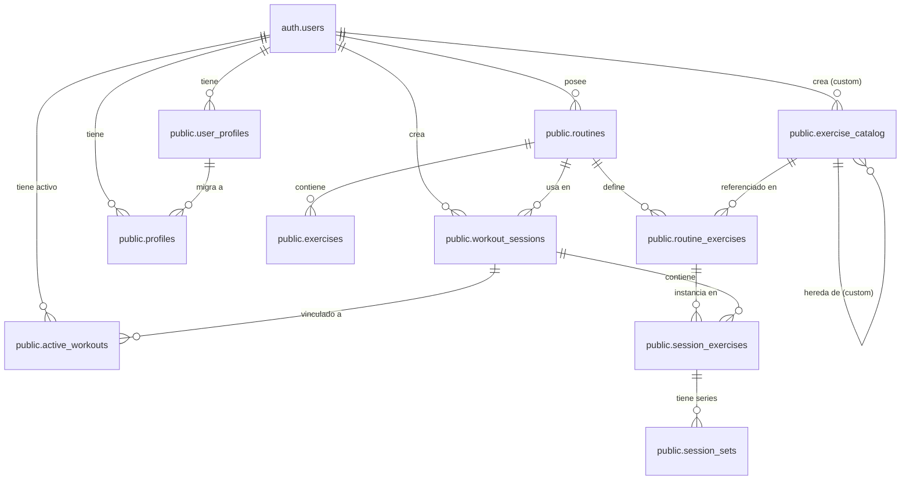

# Diagrama ER — Base de Datos GymLogiX

Este documento documenta el esquema completo de la base de datos de GymLogiX, incluyendo todas las tablas, relaciones, claves foráneas y políticas de Row Level Security (RLS).

## 1. Diagrama de Relaciones (ER)



## 2. Tablas y Columnas

### 2.1. Tabla: `public.routines`
| Columna | Tipo | Restricciones | Descripción |
|---------|------|---------------|-------------|
| id | uuid | PK, default uuid_generate_v4() | Identificador único |
| user_id | uuid | FK → auth.users, NOT NULL | Usuario propietario |
| name | text | NOT NULL | Nombre de la rutina |
| description | text | Opcional | Descripción |
| image_url | text | Opcional | URL de imagen |
| rest_between_sets | integer | Default 60 | Descanso entre series (seg) |
| rest_between_exercises | integer | Default 120 | Descanso entre ejercicios (seg) |
| created_at | timestamp | Default now() | Fecha creación |
| updated_at | timestamp | Default now() | Fecha actualización (trigger) |

### 2.2. Tabla: `public.exercises`
| Columna | Tipo | Restricciones | Descripción |
|---------|------|---------------|-------------|
| id | uuid | PK, default uuid_generate_v4() | Identificador único |
| routine_id | uuid | FK → routines, NOT NULL | Rutina padre |
| name | text | NOT NULL | Nombre del ejercicio |
| sets | integer | NOT NULL | Número de series |
| reps | integer | NOT NULL | Repeticiones por serie |
| weight | numeric | Opcional | Peso (kg) |
| notes | text | Opcional | Notas |
| order_index | integer | NOT NULL | Orden en la rutina |
| created_at | timestamp | Default now() | Fecha creación |

### 2.3. Tabla: `public.workout_sessions`
| Columna | Tipo | Restricciones | Descripción |
|---------|------|---------------|-------------|
| id | uuid | PK, default uuid_generate_v4() | Identificador único |
| user_id | uuid | FK → auth.users, NOT NULL | Usuario |
| routine_id | uuid | FK → routines, NOT NULL | Rutina entrenada |
| date | timestamp | Default now() | Fecha y hora |
| created_at | timestamp | Default now() | Fecha creación |

### 2.4. Tabla: `public.session_exercises`
| Columna | Tipo | Restricciones | Descripción |
|---------|------|---------------|-------------|
| id | uuid | PK, default uuid_generate_v4() | Identificador único |
| session_id | uuid | FK → workout_sessions, NOT NULL | Sesión padre |
| exercise_id | uuid | FK → exercises, NOT NULL | Ejercicio |
| completed_sets | integer | NOT NULL | Series completadas |
| actual_reps | integer[] | NOT NULL | Repeticiones reales (array) |
| actual_weight | numeric[] | NOT NULL | Pesos reales (array) |
| created_at | timestamp | Default now() | Fecha creación |

**Check constraint:** `array_length(actual_reps, 1) = array_length(actual_weight, 1)`

### 2.5. Tabla: `public.user_profiles`
| Columna | Tipo | Restricciones | Descripción |
|---------|------|---------------|-------------|
| id | uuid | PK, default uuid_generate_v4() | Identificador único |
| user_id | uuid | FK → auth.users, UNIQUE | Usuario |
| age | integer | Opcional | Edad |
| gender | text | CHECK: male/female/other | Género |
| height | numeric | Opcional | Altura (cm) |
| weight | numeric | Opcional | Peso (kg) |
| weight_history | jsonb | Default '[]' | Historial de peso |
| fitness_goal | text | CHECK: muscle_gain/strength/... | Objetivo |
| fitness_level | text | CHECK: beginner/intermediate/advanced | Nivel |
| weekly_workouts | integer | Opcional | Entrenamientos por semana |
| created_at | timestamp | Default now() | Fecha creación |
| updated_at | timestamp | Default now() | Fecha actualización |
### 2.6. Tabla: `public.profiles` (unificada)
| Columna | Tipo | Restricciones | Descripción |
|---------|------|---------------|-------------|
| id | uuid | PK, default uuid_generate_v4() | Identificador único |
| user_id | uuid | FK → auth.users, UNIQUE | Usuario |
| age | integer | Opcional | Edad |
| gender | text | CHECK: male/female/other | Género |
| height | numeric | Opcional | Altura (cm) |
| weight | numeric | Opcional | Peso (kg) |
| weight_history | jsonb | Default '[]' | Historial de peso |
| fitness_goal | text | CHECK | Objetivo |
| fitness_level | text | CHECK | Nivel |
| weekly_workouts | integer | Default 3 | Entrenamientos/semana |
| weekly_plan | jsonb | Default '{}' | Plan semanal |
| last_weights | jsonb | Default '{}' | Últimos pesos por ejercicio |
| created_at | timestamp | Default now() | Fecha creación |
| updated_at | timestamp | Default now() | Fecha actualización |

### 2.7. Tabla: `public.exercise_catalog`
| Columna | Tipo | Restricciones | Descripción |
|---------|------|---------------|-------------|
| id | uuid | PK, default uuid_generate_v4() | Identificador único |
| user_id | uuid | FK → auth.users | Usuario (NULL = público) |
| name | text | NOT NULL | Nombre del ejercicio |
| muscle_group | text | NOT NULL | Grupo muscular |
| equipment | text | Opcional | Equipamiento |
| default_sets | integer | Default 3 | Series por defecto |
| default_reps | integer | Default 10 | Repeticiones por defecto |
| default_rest_seconds | integer | Default 60 | Descanso (seg) |
| youtube_video_id | text | Opcional | ID de video |
| image_url | text | Opcional | URL de imagen |
| technique | text[] | Opcional | Técnica (array) |
| instructions | text[] | Opcional | Instrucciones (array) |
| is_custom | boolean | Default false | Ejercicio personalizado |
| is_public | boolean | Default true | Visible para todos |
| created_at | timestamp | Default now() | Fecha creación |
| updated_at | timestamp | Default now() | Fecha actualización |

### 2.8. Tabla: `public.routine_exercises`
| Columna | Tipo | Restricciones | Descripción |
|---------|------|---------------|-------------|
| id | uuid | PK, default uuid_generate_v4() | Identificador único |
| routine_id | uuid | FK → routines, NOT NULL | Rutina |
| catalog_exercise_id | uuid | FK → exercise_catalog | Ejercicio catálogo |
| name | text | NOT NULL | Nombre del ejercicio |
| sets | integer | NOT NULL | Número de series |
| reps | integer | NOT NULL | Repeticiones |
| weight | numeric | Opcional | Peso |
| rest_seconds | integer | Opcional | Descanso (seg) |
| order_index | integer | NOT NULL | Orden |
| created_at | timestamp | Default now() | Fecha creación |

### 2.9. Tabla: `public.session_sets`
| Columna | Tipo | Restricciones | Descripción |
|---------|------|---------------|-------------|
| id | uuid | PK, default uuid_generate_v4() | Identificador único |
| session_exercise_id | uuid | FK → session_exercises, NOT NULL | Serie del ejercicio |
| set_number | integer | NOT NULL | Número de serie |
| planned_reps | integer | Opcional | Repeticiones planificadas |
| planned_weight | numeric | Opcional | Peso planificado |
| actual_reps | integer | Opcional | Repeticiones reales |
| actual_weight | numeric | Opcional | Peso real |
| rpe | integer | CHECK 1-10 | Rate of Perceived Exertion |
| rir | integer | CHECK 0-10 | Reps In Reserve |
| completed | boolean | Default false | Completada |
| started_at | timestamp | Opcional | Inicio |
| completed_at | timestamp | Opcional | Finalización |
| rest_taken_seconds | integer | Opcional | Descanso real |
| notes | text | Opcional | Notas |
| created_at | timestamp | Default now() | Fecha creación |

### 2.10. Tabla: `public.active_workouts`
| Columna | Tipo | Restricciones | Descripción |
|---------|------|---------------|-------------|
| id | uuid | PK, default uuid_generate_v4() | Identificador único |
| user_id | uuid | FK → auth.users, NOT NULL | Usuario |
| session_id | uuid | FK → workout_sessions | Sesión activa |
| current_exercise_id | uuid | Opcional | Ejercicio actual |
| current_set_number | integer | Default 1 | Serie actual |
| is_paused | boolean | Default false | Pausado |
| paused_at | timestamp | Opcional | Pausa |
| rest_timer_ends_at | timestamp | Opcional | Fin del descanso |
| created_at | timestamp | Default now() | Fecha creación |
| updated_at | timestamp | Default now() | Fecha actualización |

## 3. Row Level Security (RLS)

Todas las tablas tienen RLS habilitado con las siguientes políticas:

### 3.1. `routines`
| Política | Acción | Condición |
|----------|--------|-----------|
| Users can view their own routines | SELECT | `auth.uid() = user_id` |
| Users can create their own routines | INSERT | `auth.uid() = user_id` |
| Users can update their own routines | UPDATE | `auth.uid() = user_id` |
| Users can delete their own routines | DELETE | `auth.uid() = user_id` |

### 3.2. `exercises`
| Política | Acción | Condición |
|----------|--------|-----------|
| Users can view exercises from their routines | SELECT | Existe routine con `user_id = auth.uid()` |
| Users can create exercises for their routines | INSERT | Existe routine con `user_id = auth.uid()` |
| Users can update exercises from their routines | UPDATE | Existe routine con `user_id = auth.uid()` |
| Users can delete exercises from their routines | DELETE | Existe routine con `user_id = auth.uid()` |

### 3.3. `workout_sessions`
| Política | Acción | Condición |
|----------|--------|-----------|
| Users can view their own sessions | SELECT | `auth.uid() = user_id` |
| Users can create their own sessions | INSERT | `auth.uid() = user_id` |
| Users can update their own sessions | UPDATE | `auth.uid() = user_id` |
| Users can delete their own sessions | DELETE | `auth.uid() = user_id` |

### 3.4. `session_exercises`
| Política | Acción | Condición |
|----------|--------|-----------|
| Users can view session exercises from their sessions | SELECT | Existe sesión del usuario |
| Users can create session exercises for their sessions | INSERT | Existe sesión del usuario |
| Users can update session exercises from their sessions | UPDATE | Existe sesión del usuario |
| Users can delete session exercises from their sessions | DELETE | Existe sesión del usuario |

### 3.5. `user_profiles` / `profiles`
| Política | Acción | Condición |
|----------|--------|-----------|
| Users can view their own profile | SELECT | `auth.uid() = user_id` |
| Users can create their own profile | INSERT | `auth.uid() = user_id` |
| Users can update their own profile | UPDATE | `auth.uid() = user_id` |
| Users can delete their own profile | DELETE | `auth.uid() = user_id` |

### 3.6. `exercise_catalog`
| Política | Acción | Condición |
|----------|--------|-----------|
| Users can view public exercises and their own custom exercises | SELECT | `is_public = true OR auth.uid() = user_id` |
| Users can create their own custom exercises | INSERT | `auth.uid() = user_id` |
| Users can update their own custom exercises | UPDATE | `auth.uid() = user_id` |
| Users can delete their own custom exercises | DELETE | `auth.uid() = user_id` |

### 3.7. `routine_exercises`
| Política | Acción | Condición |
|----------|--------|-----------|
| Users can view routine exercises from their routines | SELECT | Existe routine con `user_id = auth.uid()` |
| Users can create routine exercises for their routines | INSERT | Existe routine con `user_id = auth.uid()` |
| Users can update routine exercises from their routines | UPDATE | Existe routine con `user_id = auth.uid()` |
| Users can delete routine exercises from their routines | DELETE | Existe routine con `user_id = auth.uid()` |

### 3.8. `session_sets`
| Política | Acción | Condición |
|----------|--------|-----------|
| Users can view session sets from their sessions | SELECT | Existe sesión del usuario |
| Users can create session sets for their sessions | INSERT | Existe sesión del usuario |
| Users can update session sets from their sessions | UPDATE | Existe sesión del usuario |
| Users can delete session sets from their sessions | DELETE | Existe sesión del usuario |

### 3.9. `active_workouts`
| Política | Acción | Condición |
|----------|--------|-----------|
| Users can view their own active workouts | SELECT | `auth.uid() = user_id` |
| Users can create their own active workouts | INSERT | `auth.uid() = user_id` |
| Users can update their own active workouts | UPDATE | `auth.uid() = user_id` |
| Users can delete their own active workouts | DELETE | `auth.uid() = user_id` |

## 4. Triggers

| Tabla | Trigger | Función | Evento |
|-------|---------|---------|--------|
| routines | handle_routines_updated_at | handle_updated_at() | BEFORE UPDATE |
| user_profiles | handle_user_profiles_updated_at | handle_updated_at() | BEFORE UPDATE |
| profiles | handle_profiles_updated_at | handle_updated_at() | BEFORE UPDATE |
| exercise_catalog | handle_exercise_catalog_updated_at | handle_updated_at() | BEFORE UPDATE |
| routine_exercises | handle_routine_exercises_updated_at | handle_updated_at() | BEFORE UPDATE |
| session_sets | handle_session_sets_updated_at | handle_updated_at() | BEFORE UPDATE |
| active_workouts | handle_active_workouts_updated_at | handle_updated_at() | BEFORE UPDATE |

La función `handle_updated_at()` establece `updated_at = timezone('utc', now())` automáticamente.

## 5. Índices

| Tabla | Índice | Columnas | Propósito |
|-------|--------|----------|-----------|
| routines | routines_user_id_idx | user_id | Consultas por usuario |
| exercises | exercises_routine_id_idx | routine_id | Consultas por rutina |
| workout_sessions | workout_sessions_user_id_idx | user_id | Historial de usuario |
| workout_sessions | workout_sessions_routine_id_idx | routine_id | Sesiones por rutina |
| workout_sessions | workout_sessions_user_date_idx | user_id, date DESC | Historial ordenado por fecha |
| session_exercises | session_exercises_session_id_idx | session_id | Ejercicios por sesión |
| session_exercises | session_exercises_exercise_id_idx | exercise_id | Historial por ejercicio |
| user_profiles | user_profiles_user_id_idx | user_id | Perfil por usuario |
| profiles | profiles_user_id_idx | user_id | Perfil por usuario |
| exercise_catalog | exercise_catalog_muscle_group_idx | muscle_group, is_public | Filtros por grupo muscular |
| routine_exercises | routine_exercises_routine_order_idx | routine_id, order_index | Ejercicios ordenados |
| session_sets | session_sets_session_exercise_idx | session_exercise_id, set_number | Series ordenadas |
| active_workouts | active_workouts_user_id_idx | user_id | Entrenamiento activo |

## 6. Flujo de Datos (Resumen)

```
Usuario autentica → Crea rutina (routines + exercises)
         ↓
     Inicia sesión (workout_sessions + active_workouts)
         ↓
     Registra series (session_exercises + session_sets)
         ↓
     Finaliza entrenamiento (actualiza workout_sessions)
         ↓
     Actualiza perfil (user_profiles / profiles)
         ↓
     Progreso disponible en dashboard
```

## 7. Migraciones

| Archivo | Descripción |
|---------|-------------|
| `supabase/schema.sql` | Esquema inicial completo |
| `supabase/migrations/001_add_sets_data.sql` | Añade columna sets_data |
| `supabase/migrations/002_make_old_columns_nullable.sql` | Hace columnas antiguas opcionales |
| `supabase/migrations/2026-02-12_add_last_weights_to_profiles.sql` | Añade last_weights |
| `supabase/migrations/2026-02-12_add_weekly_plan.sql` | Añade weekly_plan |
| `supabase/migrations/2026-02-12_create_active_workouts_table.sql` | Crea active_workouts |
| `supabase/migrations/2026-02-12_create_profiles_table_if_missing.sql` | Crea profiles |
| `supabase/migrations/2026-02-17_active_workouts_complete.sql` | Completa active_workouts |
| `supabase/migrations/2026-02-28_add_exercise_rest_fields.sql` | Añade campos de descanso |
| `supabase/migrations/2026-09-10_profiles_rls_policies.sql` | Políticas RLS para profiles |
| `supabase/migrations/2026-09-10_weight_history_jsonb.sql` | weight_history como JSONB |
| `supabase/migrations/2026-09-19_session_exercise_ref_id.sql` | Añade exercise_ref_id |
| `supabase/migrations/2026-10-20_new_tables_and_rls.sql` | Nuevas tablas + RLS |
| `supabase/migrations/2026-10-21_populate_exercise_catalog.sql` | 280 ejercicios en catálogo |

