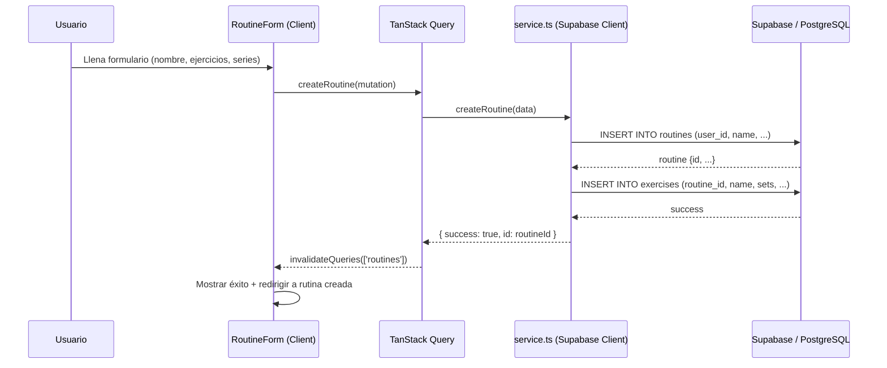
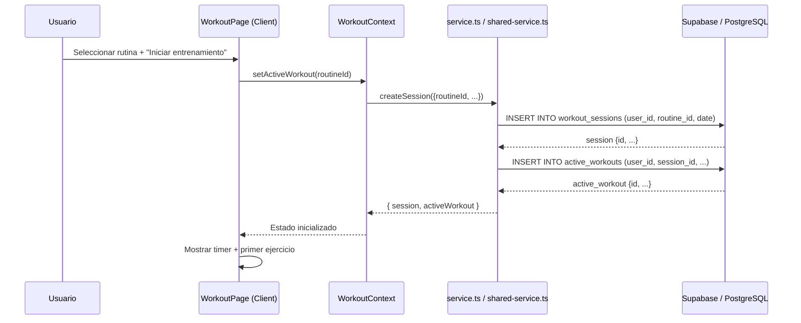
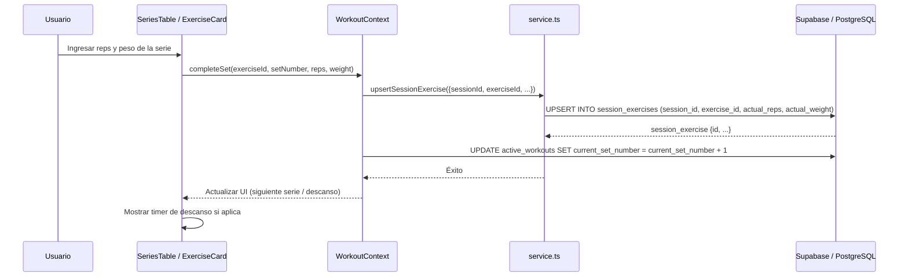
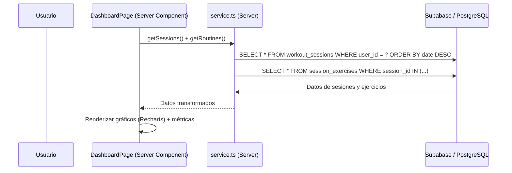
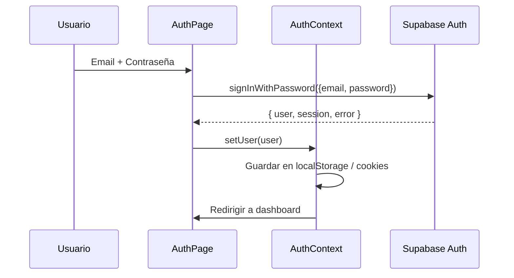

# Flujo de Datos — GymLogiX

Este documento describe cómo viajan los datos a través de la aplicación, desde la interfaz de usuario hasta la base de datos de Supabase y viceversa.

## 1. Arquitectura de Capas de Datos

La aplicación utiliza una **doble capa de datos** para soportar tanto web (SSR) como móvil (Capacitor/PWA):

```
┌─────────────────────────────────────────────────────────────────────────────┐
│                          CLIENTE (Navegador / App Móvil)                    │
│  ┌─────────────┐  ┌─────────────┐  ┌─────────────┐  ┌─────────────────┐   │
│  │  UI Layer   │  │  React      │  │  TanStack   │  │  Supabase       │   │
│  │  (Components│  │  Contexts   │  │  Query v5   │  │  Client (SSR)   │   │
│  │   + Hooks)  │  │  (Providers)│  │  (Cache)    │  │  + Service.ts   │   │
│  └──────┬──────┘  └──────┬──────┘  └──────┬──────┘  └────────┬────────┘   │
│         │                │                │                   │            │
│         ▼                ▼                ▼                   ▼            │
└─────────────────────────────────────────────────────────────────────────────┘
│                              SUPABASE (PostgreSQL)                          │
│  ┌─────────────────────────────────────────────────────────────────────┐   │
│  │  auth.users         routines         workout_sessions               │   │
│  │  user_profiles      exercises        session_exercises              │   │
│  │  profiles           exercise_catalog session_sets                   │   │
│  │                                                       active_workouts│   │
│  └─────────────────────────────────────────────────────────────────────┘   │
└─────────────────────────────────────────────────────────────────────────────┘
```

## 2. Flujo de Datos por Caso de Uso

### 2.1. Crear una Rutina



### 2.2. Iniciar un Entrenamiento



### 2.3. Registrar una Serie



### 2.4. Consultar Progreso (Dashboard)



## 3. Capa de Caché (TanStack Query)

```
┌─────────────────────────────────────────────────────────────┐
│                    TanStack Query v5                        │
│  ┌───────────────────────────────────────────────────────┐  │
│  │  Query Key: ['routines', 'list']                      │  │
│  │  staleTime: 5 min (datos de usuario)                  │  │
│  │  gcTime: 10 min                                       │  │
│  │  refetchOnWindowFocus: false                          │  │
│  └───────────────────────────────────────────────────────┘  │
│  ┌───────────────────────────────────────────────────────┐  │
│  │  Query Key: ['exercises', 'muscle', 'pecho']          │  │
│  │  staleTime: Infinity (datos estáticos)                │  │
│  │  refetchOnMount: false                                │  │
│  └───────────────────────────────────────────────────────┘  │
└─────────────────────────────────────────────────────────────┘
```

## 4. Flujo de Autenticación



## 5. Flujo Offline (PWA / Móvil)

```
┌─────────────────────────────────────────────────────────────┐
│                      Estrategia Offline-First               │
│                                                             │
│  1. Intento de escritura a Supabase                         │
│     ├─ Éxito → Datos se persisten en DB + caché local       │
│     └─ Fallo (sin conexión) → Guardar en saveQueue          │
│                                                         │
│  2. saveQueue (IndexedDB / LocalStorage)                    │
│     ├─ Al recuperar conexión → flush() de operaciones       │
│     ├─ Cada operación se reintenta con backoff exponencial  │
│     └─ Max 3 reintentos antes de marcar como fallida        │
│                                                             │
│  3. Lecturas                                                │
│     ├─ Primero caché de TanStack Query                      │
│     ├─ Si no hay caché y sin conexión → mostrar estado vacío│
│     └─ Si hay conexión → fetch desde Supabase               │
└─────────────────────────────────────────────────────────────┘
```

## 6. Responsabilidades por Capa

| Capa | Responsabilidad | Tecnología |
|------|----------------|------------|
| **UI Layer** | Presentación, captura de entrada, navegación | React 19, Next.js 16, Tailwind CSS |
| **React Context** | Estado global de sesión (auth, tema, workout, equipo) | React Context API |
| **TanStack Query** | Caché de servidor, sincronización, mutaciones optimistas | TanStack Query v5 |
| **Supabase Service** | Operaciones CRUD, autenticación, RLS | @supabase/ssr, @supabase/supabase-js |
| **Supabase DB** | Almacenamiento persistente, integridad referencial, RLS | PostgreSQL 15+ |

## 7. Decisiones Arquitectónicas Clave

| Decisión | Razón | Documentada en |
|----------|-------|----------------|
| Doble capa de datos (service.ts + API Routes) | Compatibilidad con build estático móvil (Capacitor) | `docs/ADR/001-dual-data-layer.md` |
| Carga diferida de ejercicios por grupo muscular | Reducir bundle inicial de ~500 KB a ~35 KB | `docs/ADR/002-lazy-loading-exercises.md` |
| Offline-first con saveQueue | Soportar uso sin conexión en gimnasios | `docs/ADR/003-offline-first.md` |
| RLS en todas las tablas | Seguridad a nivel de fila sin middleware adicional | `supabase/schema.sql` |
